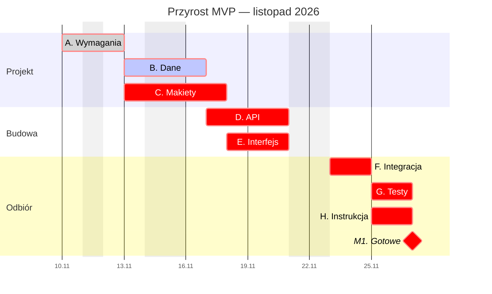
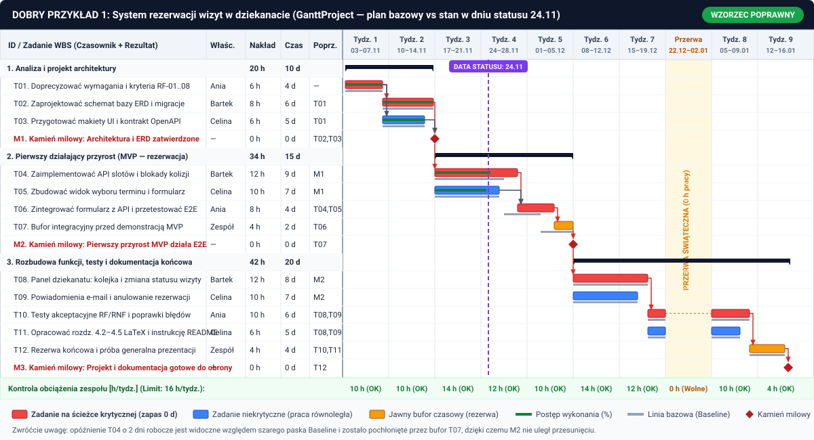
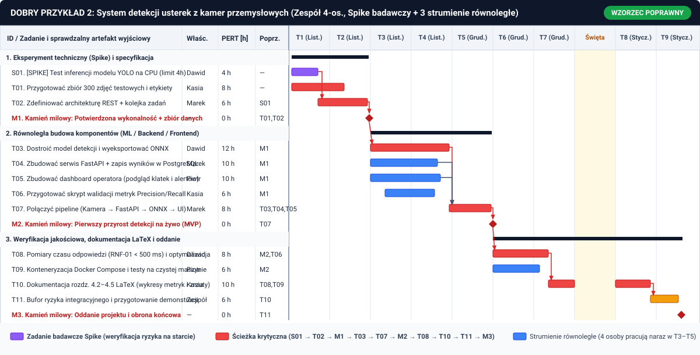
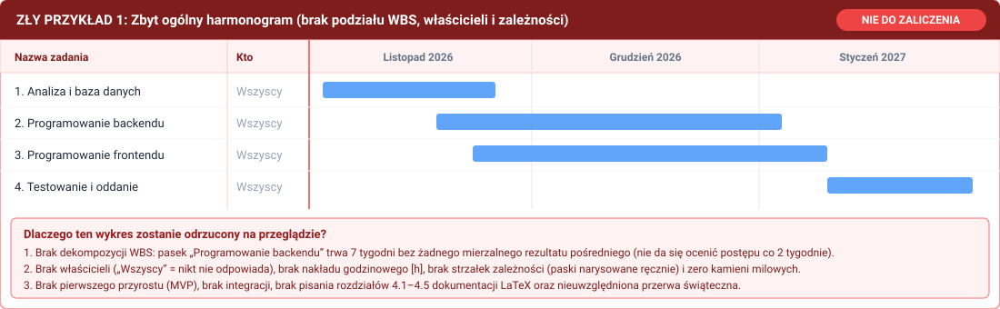
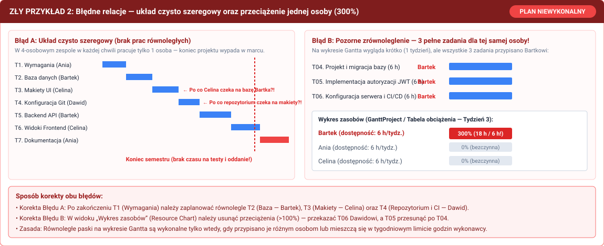
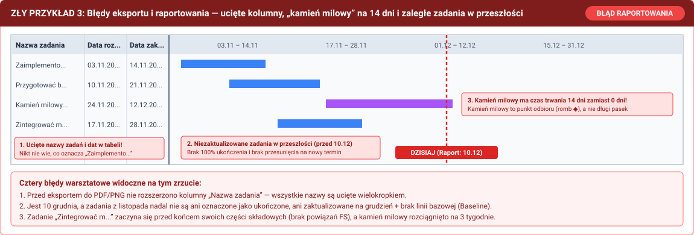

# Laboratorium: planowanie prac projektowych i budowa diagramu Gantta krok po kroku

Praca wykonywana jest w zespołach projektowych (3–4 osoby). Celem laboratorium jest przełożenie wymagań i przypadków użycia na wykonalny harmonogram prac oraz przećwiczenie jego budowy, analizy i aktualizacji w narzędziach open source lub komercyjnych.

Poprawny harmonogram Gantta określa pięć powiązanych ze sobą elementów:
1. **Zakres i rezultaty** — struktura podziału pracy (WBS) i produkty cząstkowe projektu.
2. **Odpowiedzialność** — właściciel każdego zadania oraz jego tygodniowa dostępność godzinowa.
3. **Nakład a czas trwania** — liczba roboczogodzin potrzebnych na wykonanie zadania a czas kalendarzowy w dniach roboczych.
4. **Kolejność prac** — zależności techniczne między zadaniami oraz kamienie milowe.
5. **Wrażliwość na opóźnienia** — ścieżka krytyczna, obciążenie zasobów oraz rezerwa czasowa.

---

## Powiązanie narzędzi planistycznych: Roadmap, Gantt i Kanban

W inżynierii oprogramowania planowanie i sterowanie pracą zespołu (oraz zadaniami wykonywanymi przez zautomatyzowane agenty programistyczne) odbywa się na trzech uzupełniających się poziomach szczegółowości. Wykres Gantta nie zastępuje tablicy Kanban ani mapy drogowej produktu — każdy z tych widoków pełni inną funkcję:

- **Roadmap (Mapa drogowa) — planowane funkcjonalności i wydania:**
  Określa kierunek rozwoju systemu w skali całego semestru lub kolejnych wersji produktu (np. `v0.1 — Pierwszy przyrost MVP`, `v0.2 — Panel administracyjny i powiadomienia`, `v1.0 — Wersja końcowa po testach akceptacyjnych`). Operuje na dużych blokach funkcjonalnych (epikach) i kamieniach milowych, bez dzielenia pracy na pojedyncze czynności techniczne.
- **Gantt — zależności między większymi etapami i zadaniami na osi czasu:**
  Modeluje powiązania logiczne (`FS`, `SS`, `FF`) między etapami oraz zadaniami z WBS, wyznacza ścieżkę krytyczną, zapasy czasu (*Slack*), punkty integracji komponentów oraz linię bazową (*Baseline*). Pozwala ocenić, jak opóźnienie jednego etapu wpływa na terminy kolejnych prac i datę oddania projektu.
- **Kanban — bieżące zadania operacyjne członków zespołu i agentów:**
  Służy do codziennego sterowania przepływem pracy w krótkim horyzoncie (bieżący tydzień lub dwutygodniowy okres raportowy). Zadania wybrane z aktualnego etapu Gantta przechodzą przez kolumny statusów (`Do wykonania → W toku → Przegląd kodu / Testy → Gotowe`) z ograniczeniem liczby zadań realizowanych jednocześnie (*WIP — Work in Progress limit*). W projektach wspomaganych przez agenty AI (np. agenty kodujące lub testujące) pojedyncza karta na tablicy Kanban reprezentuje izolowane zadanie powiązane z osobną gałęzią Git i Pull Requestem.

### Porównanie widoków: Roadmap vs Gantt vs Kanban

| Kryterium | Roadmap (Mapa drogowa) | Diagram Gantta | Tablica Kanban |
|---|---|---|---|
| **Główne przeznaczenie** | Planowane funkcjonalności, przyrosty i wydania systemu | Zależności między większymi etapami i zadaniami, ścieżka krytyczna, obciążenie w czasie | Bieżące zadania wykonawcze członków zespołu lub agentów |
| **Podstawowe pytanie** | *Jakie funkcje wejdą do kolejnych wydań i kiedy nastąpią odbiory?* | *W jakiej kolejności muszą powstawać etapy i co opóźni termin końcowy?* | *Nad czym trwa praca w bieżącym tygodniu, co czeka na weryfikację i co jest zablokowane?* |
| **Jednostka pracy (ziarnistość)** | Wydanie (*Release*), epik (*Epic*), przyrost funkcjonalny | Etap WBS, zadanie projektowe (4–16 h / 1–2 tygodnie), kamień milowy ($\diamond$) | Pojedyncze zgłoszenie (*Issue*), podzadanie techniczne, Pull Request (1–4 h) |
| **Sposób reprezentacji czasu** | Przedziały czasowe (miesiące, etapy semestru, kwartały) | Dokładna oś kalendarzowa (dni robocze / tygodnie), strzałki poprzedników, *Baseline* | Brak osi czasu — liczy się status w kolumnie, kolejność priorytetów i czas przejścia (*Cycle Time*) |
| **Narzędzia Open Source / Darmowe** | GitHub Projects (widok *Roadmap*), OpenProject Roadmap | **GanttProject**, **ProjectLibre Desktop**, OpenProject Gantt, Mermaid.js | GitHub Projects (widok *Board*), GitLab Issue Boards, Taiga, Plane, Focalboard |
| **Narzędzia komercyjne** | GitLab Roadmap (**Premium / Ultimate**), Jira Plans / Product Discovery, Linear Roadmaps, Asana Goals, Productboard | Asana (*Gantt view*), MS Project, ClickUp Gantt, Jira Timeline / BigPicture | Jira Software (*Kanban Board*), Linear, Trello, Asana (*Board view*), YouTrack |

GitLab Roadmap wymaga planu Premium lub Ultimate — zob. [oficjalna dokumentacja funkcji](https://docs.gitlab.com/user/group/roadmap/). Dostęp do pozostałych funkcji również należy sprawdzić dla planu używanego przez zespół.

### Przepływ pracy łączący Roadmap, Gantt i Kanban w projekcie inżynierskim

1. **Poziom 1 — Roadmap (zakres wydań):** Podzielić wymagania z rozdziału 4.1 na 2–3 główne wydania (np. *Przyrost 1: MVP*, *Przyrost 2: Pełna funkcjonalność*, *Wydanie końcowe: Testy i dokumentacja*) zakończone kamieniami milowymi `M1–M3`.
2. **Poziom 2 — Gantt (harmonogram i zależności):** Rozbić każde wydanie na etapy WBS i zadania wykonawcze (12–20 zadań), połączyć je relacjami zależności, zweryfikować obciążenie godzinowe zespołu i zapisać plan bazowy (*Baseline*) do rozdziału 4.3 dokumentacji.
3. **Poziom 3 — Kanban (realizacja bieżąca w repozytorium):** Dla zadań przypadających na bieżące dwa tygodnie utworzyć zgłoszenia (*Issues*) na tablicy Kanban w repozytorium (GitHub Projects / GitLab Boards / Jira). Po zamknięciu kart w kolumnie `Gotowe` (wraz z zatwierdzonym commitem lub Pull Requestem) odzwierciedlić postęp na wykresie Gantta podczas dwutygodniowego raportu.

---

## Organizacja pracy na laboratorium

### Wymagane materiały wejściowe
- Zaakceptowany zakres projektu, lista wymagań funkcjonalnych (`RF-...`) i niefunkcjonalnych (`RNF-...`) oraz diagram przypadków użycia z poprzednich laboratoriów.
- Kalendarz semestru zimowego 2026/2027 (daty kolejnych laboratoriów, dni wolne, terminy kolokwiów, wyjazdów i przerwy świątecznej).
- Wstępnie opracowane **Kroki 1–5** z niniejszej instrukcji: zakres, WBS, dostępność, szacunki, zależności i kamienie milowe (przygotowanie przed zajęciami).
- Komputer z zainstalowanym programem desktopowym open source (**GanttProject** lub **ProjectLibre Desktop**) albo skonfigurowanym dostępem zespołowym do wybranego narzędzia online. Zakup płatnej licencji nie jest wymagany.

### Harmonogram pracy podczas zajęć (3 godziny lekcyjne — 135 minut)

| Etap zajęć | Czas | Zadanie do wykonania na laboratorium | Rezultat kontrolny |
|---|---:|---|---|
| **Etap 0** | 15 min | Przedstawienie raportu postępu nr 4 (prace od Lab 3) | Wpis raportu nr 4 w dzienniku zespołu |
| **Etap 1** | 25 min | Weryfikacja WBS, dostępności, szacunków PERT i zależności (Kroki 1–5) | Tabela 12–20 zadań projektu z czasami i poprzednikami |
| **Etap 2** | 25 min | Odtworzenie modelu referencyjnego (Krok 6) w wybranym narzędziu (Krok 7) | Plik `przyklad.gan` / `.pod` / projekt testowy zgodny z D1–D12 |
| **Etap 3** | 35 min | Budowa harmonogramu projektu docelowego, przypisanie osób i usunięcie przeciążeń (Krok 7–8) | Plik `harmonogram-bazowy` bez konfliktów zasobów |
| **Etap 4** | 20 min | Symulacja opóźnienia na ścieżce krytycznej, dodanie ryzyk i rezerwy (Krok 8–9) | Zapisany wynik eksperymentu opóźnienia + tabela ryzyk |
| **Etap 5** | 15 min | Eksport wykresu, wzajemny przegląd z sąsiednim zespołem i weryfikacja listy kontrolnej (Krok 10–12) | Czytelny plik PDF/PNG gotowy do wstawienia w rozdz. 4.3 LaTeX |

**Po zajęciach:** przygotować dodatkowy diagram techniczny do rozdziału 4.2, uzupełnić opis harmonogramu i skompilować dokumentację LaTeX. Ta praca własna nie wchodzi w powyższe 135 minut.

---

## Część I. Przygotowanie danych wejściowych przed narysowaniem wykresu (Kroki 1–5)

Narzędzie do harmonogramowania wylicza daty na podstawie wprowadzonych zadań, czasów i relacji. Przed rozpoczęciem pracy w programie należy przygotować dane wejściowe według Kroków 1–5.

### Krok 1. Określenie rezultatu końcowego, zakresu minimalnego (MVP) i pierwszego przyrostu

W dokumentacji roboczej należy zapisać w trzech punktach:
- **Odbiorca i problem:** użytkownik docelowy oraz sytuacja, w której korzysta z systemu.
- **Zakres minimalny (MVP):** zestaw funkcji niezbędnych do rozwiązania problemu i odbioru projektu.
- **Poza zakresem:** funkcje świadomie wyłączone z realizacji w bieżącym semestrze w celu dotrzymania terminu oddania.

> **Przykład (System rezerwacji sal laboratoryjnych):**
> - **Cel i MVP:** Student sprawdza wolne terminy sali i składa rezerwację; system blokuje podwójną rezerwację tej samej sali w tym samym przedziale czasu; prowadzący zatwierdza lub odrzuca zgłoszenie. Pierwsza wersja działa lokalnie na bazie danych z zestawem danych testowych.
> - **Poza zakresem:** Integracja z systemem USOS, logowanie uczelniane SSO, powiadomienia SMS.
> - **Pierwszy działający przyrost:** Jeden pełny przebieg głównego scenariusza od początku do końca (wyszukanie sali → formularz rezerwacji → zapis w bazie → potwierdzenie i blokada terminu), zaplanowany najpóźniej w połowie czasu pozostałego do oddania projektu.

#### Ćwiczenie 1.1 — Karta zakresu harmonogramu (do wypełnienia dla projektu zespołu)

```markdown
1. Nazwa projektu i data końcowego oddania: ..................................................
2. Zakres minimalny (MVP) powiązany z wymaganiami (np. RF-01..RF-06): ........................
3. Elementy wyłączone z zakresu w bieżącym semestrze: ........................................
4. Zakres i termin pierwszego działającego przyrostu: ........................................
```

---

### Krok 2. Podział pracy na zadania — struktura WBS

**WBS (Work Breakdown Structure)** to hierarchiczny podział projektu na mniejsze zadania wykonawcze. Zamiast pojedynczego paska „Programowanie (6 tygodni)”, należy utworzyć **6 etapów nadrzędnych (grup sumarycznych)** i przyporządkować do nich zadania szczegółowe:

1. **Analiza i domknięcie wymagań** (doprecyzowanie modelu danych, weryfikacja danych wejściowych)
2. **Projekt rozwiązania** (architektura, schemat bazy danych ERD, makiety interfejsu, specyfikacja API)
3. **Pierwszy działający przyrost (MVP)** (szkielet aplikacji, główny scenariusz od interfejsu do bazy danych)
4. **Rozbudowa funkcji** (pozostałe wymagania funkcjonalne, walidacja danych, obsługa błędów)
5. **Integracja, testy i poprawki** (testy scenariuszy użycia, testy niefunkcjonalne, naprawa wykrytych błędów)
6. **Dokumentacja i oddanie** (rozdziały 4.1–4.5 w LaTeX, instrukcja uruchomienia `README`, przygotowanie prezentacji i demonstracji)

#### Zasady definiowania zadań w WBS
- **Nazwa zadania = czasownik + konkretny rezultat:** należy stosować zapis typu *„Zaimplementować endpoint `POST /reservations` z walidacją kolizji terminów”* zamiast ogólników typu *„Backend”*.
- **Sprawdzalne kryterium ukończenia:** warunek pozwalający jednoznacznie zweryfikować, że zadanie zostało w pełni wykonane.
- **Jeden właściciel:** nawet gdy nad zadaniem współpracują dwie osoby, należy wskazać jedną osobę odpowiedzialną za jego koordynację i odbiór.
- **Poziom szczegółowości (4–16 roboczogodzin / maksymalnie 1–2 tygodnie kalendarzowe):**
  - Czynności kilkunastominutowe (np. *„Założenie repozytorium Git”* lub *„Zmiana koloru przycisku”*) należy połączyć w jedno większe zadanie (np. *„Konfiguracja środowiska, repozytorium i CI”*).
  - Zadania trwające 3–4 tygodnie bez wyniku pośredniego utrudniają wczesne wykrycie opóźnień — należy podzielić je na mniejsze części kończące się sprawdzalnym rezultatem.
- **Zadanie sumaryczne (grupa) nie stanowi osobnej pracy:** jego czas trwania i nakład wynikają wyłącznie z zadań podrzędnych.

| Zbyt ogólnie (błędnie) | Konkretne zadanie w WBS (poprawnie) | Sprawdzalne kryterium ukończenia |
|---|---|---|
| Baza danych | Przygotować migracje SQL dla tabel `rooms`, `users`, `reservations` | Skrypt migracji tworzy strukturę na pustej bazie PostgreSQL i ładuje dane testowe |
| Frontend | Zbudować widok kalendarza sali i formularz rezerwacji | Formularz wysyła poprawne żądanie do API i wyświetla komunikaty błędów walidacji |
| Testowanie | Przeprowadzić testy konfliktów rezerwacji według scenariusza PU-02 | Test integracyjny potwierdza kod `409 Conflict` przy nakładających się datach |
| Dokumentacja | Opisać architekturę, ERD i instrukcję uruchomienia w rozdz. 4.2 | Rozdział 4.2 kompiluje się w Overleaf, a druga osoba z zespołu uruchamia projekt wg opisu |

#### Ćwiczenie 2.1 — Tabela WBS projektu (należy przygotować 12–20 zadań)

| ID | Etap / Zadanie i oczekiwany rezultat | Powiązane wymaganie | Właściciel | Nakład pracy [h] | Czas trwania [dni rob.] | Poprzedniki (ID) | Kryterium ukończenia |
|---|---|---|---|---:|---:|---|---|
| **T01** |  |  |  |  |  |  |  |
| **T02** |  |  |  |  |  |  |  |
| ... |  |  |  |  |  |  |  |

---

### Krok 3. Określenie rzeczywistej dostępności zespołu (Nakład $\neq$ Czas trwania)

Podczas planowania należy rozróżniać dwie wielkości:
- **Nakład pracy (Work / Effort):** liczba roboczogodzin potrzebnych na wykonanie zadania (np. **8 godzin** programowania i testów).
- **Czas trwania (Duration):** liczba dni lub tygodni kalendarzowych od rozpoczęcia do zakończenia zadania, wynikająca z tygodniowej dostępności osoby wykonującej zadanie.

> **Przykład obliczeniowy:**
> Zadanie wymaga **12 h nakładu pracy**. Wykonuje je Bartek, który na Projekt inżynierski może przeznaczyć **4 h tygodniowo** (po 2 h we wtorek i czwartek).
> - W programie ustawionym domyślnie na pełny etat (8 h dziennie = 40 h tygodniowo) 12 h odpowiada **1,5 dnia roboczego**.
> - Przy dostępności 4 h tygodniowo to samo zadanie zajmie **3 tygodnie kalendarzowe (15 dni roboczych)**.

#### Zasady uwzględniania dostępności:
1. **Przerwa świąteczno-noworoczna, dni wolne i kolokwia:** należy uwzględnić tygodnie, w których dostępność członków zespołu jest ograniczona lub zerowa.
2. **Narzut komunikacyjny przy pracy wspólnej:** przydzielenie 2 osób do zadania oszacowanego na 8 h nie skraca go automatycznie do 4 h — część czasu zajmuje podział pracy, łączenie kodu (merge) i przegląd zmian (code review).
3. **Brak przeciążeń zasobów:** dla każdego członka zespołu i każdego tygodnia suma godzin wszystkich przypisanych mu w tym tygodniu zadań nie może przekraczać jego deklarowanej dostępności.

#### Ćwiczenie 3.1 — Tabela dostępności i ograniczeń kalendarzowych zespołu

| Członek zespołu | Rola w projekcie | Dostępność [h / tydzień] | Dni pracy nad projektem | Okresy ograniczonej dostępności (kolokwia, wyjazdy, praca) |
|---|---|---:|---|---|
| *Przykład: Ania* | *Backend / DB* | *6 h* | *Wt (3h), Czw (3h)* | *22.12–02.01 (przerwa świąteczna), 12–16.01 (kolokwia)* |
| 1. |  |  |  |  |
| 2. |  |  |  |  |
| 3. |  |  |  |  |
| 4. |  |  |  |  |

---

### Krok 4. Szacowanie nakładu pracy i niepewności (PERT oraz eksperyment techniczny)

Wstępny szacunek dla zadania proponuje jego właściciel, a druga osoba z zespołu weryfikuje, czy uwzględniono czas na testy, obsługę błędów, przegląd kodu i poprawki po integracji.

#### Oszacowanie trójpunktowe (PERT) dla zadań obarczonych niepewnością
Dla zadań wykonywanych po raz pierwszy (np. integracja z zewnętrznym API, konfiguracja Docker Compose, nowy framework) należy określić trzy wartości nakładu w godzinach:
- $O$ (**Optymistyczny**): przebieg bez dodatkowych trudności technicznych.
- $M$ (**Najbardziej prawdopodobny**): standardowy czas pracy z typowymi poprawkami.
- $P$ (**Pesymistyczny**): trudności z dokumentacją, błędy zależności lub konieczność korekty podejścia.

Oczekiwany nakład pracy $E$ oraz odchylenie standardowe $\sigma$ wynoszą:

$$E = \frac{O + 4M + P}{6}, \qquad \sigma = \frac{P - O}{6}$$

| Zadanie | $O$ [h] | $M$ [h] | $P$ [h] | Wyliczone $E$ [h] | Przyjęty nakład | Czas trwania przy dostępności 4 h/tydz. |
|---|---:|---:|---:|---:|---:|---:|
| Integracja z zewnętrznym API | 4 h | 8 h | 16 h | $8{,}7\text{ h}$ | **9 h** | ok. **2,5 tygodnia** (12 dni rob.) |

#### Krótki eksperyment techniczny (Spike)
Jeżeli rozrzut między $O$ a $P$ jest znaczny (np. $O = 2\text{ h}$, $P = 24\text{ h}$, z uwagi na brak pewności, czy wybrana biblioteka obsługuje wymagany format danych), należy w pierwszej kolejności zaplanować krótkie zadanie badawcze z ustalonym limitem czasu:
- *„T03a: Zweryfikować w ciągu 2 h odczyt danych z API X i zapisać skrypt testowy”* (nakład: 2 h).
Po wykonaniu próby należy skorygować szacunek właściwej implementacji.

#### Ćwiczenie 4.1 — Uzasadnienie 3 najbardziej niepewnych szacunków
Wybrać 3 zadania o największej niepewności z tabeli WBS, wyliczyć dla nich wartości $O, M, P, E$ oraz opisać w 1–2 zdaniach przyczynę różnicy między wariantem $O$ a $P$.

---

### Krok 5. Ustalenie zależności logicznych i kamieni milowych

Po zdefiniowaniu zadań i czasów ich trwania należy określić relacje poprzedzania.

#### Cztery typy relacji zależności

| Skrót | Nazwa relacji | Znaczenie | Zastosowanie w projekcie |
|---|---|---|---|
| **FS** | **Koniec – Początek** (*Finish-to-Start*) | Zadanie B może rozpocząć się po zakończeniu zadania A. | Podstawowa relacja w większości zadań: np. *Projekt schematu bazy (A) → Implementacja migracji i repozytoriów (B)*. |
| **SS** | **Początek – Początek** (*Start-to-Start*) | Zadanie B może rozpocząć się po starcie zadania A. | Gdy po rozpoczęciu implementacji API (A) druga osoba może przygotowywać testy kontraktowe lub dane testowe (B). |
| **FF** | **Koniec – Koniec** (*Finish-to-Finish*) | Zadanie B nie może zakończyć się przed zakończeniem zadania A. | Np. *Implementacja modułów (A) → Zamknięcie dokumentacji technicznej rozdz. 4.2 (B)*. |
| **SF** | **Początek – Koniec** (*Start-to-Finish*) | Zakończenie zadania B zależy od rozpoczęcia zadania A. | Stosowane wyjątkowo (np. przy przełączaniu utrzymania systemów); w projektach studenckich zwykle niepotrzebne. |

#### Reguły budowania sieci zależności:
1. **Równoległość niezależnych prac:** po zatwierdzeniu wymagań *Projekt bazy danych*, *Makiety interfejsu* oraz *Konfiguracja repozytorium* mogą powstawać równolegle.
2. **Punkty zbiegu przy integracji:** zadanie *„Integracja frontendu z API”* musi mieć jako poprzedniki wszystkie łączone elementy, np. gotowe API oraz gotowy widok interfejsu (`Poprzedniki: D, E`).
3. **Odróżnienie zależności technicznej od dostępności osoby:** jeżeli dwa niezależne widoki wykonuje ta sama osoba, wynika to z przydziału zasobów, a nie z ograniczenia technicznego — w razie potrzeby jedno z zadań można przekazać innemu członkowi zespołu.

#### Kamienie milowe (Milestones)
Kamień milowy to **punkt kontrolny o zerowym czasie trwania (`0 dni`, `0 h`)**, oznaczany na wykresie symbolem rombu ($\diamond$). Opisuje osiągnięty stan projektu i warunek odbioru etapu, a nie czynność rozciągniętą w czasie.
- **Niepoprawnie:** *„Spotkanie zespołu (2 dni)”* lub *„Testowanie aplikacji (10 dni)”* jako kamień milowy.
- **Poprawnie:** *„M1: Zatwierdzona specyfikacja i architektura”*, *„M2: Pierwszy przyrost (MVP) przechodzi test głównego scenariusza”*, *„M3: Projekt i dokumentacja gotowe do oddania”*.

W projekcie należy zaplanować **co najmniej 3 kamienie milowe** powiązane z poprzednikami i kryteriami odbioru.

---

## Część II. Analiza wspólnego modelu referencyjnego (Krok 6)

Przed wprowadzeniem własnego projektu do programu należy przećwiczyć obliczenia na wspólnym modelu **„System rezerwacji sal — pierwszy przyrost”**. Pozwala to zweryfikować, czy wybrane narzędzie wylicza terminy i ścieżkę krytyczną zgodnie z założeniami.

### Założenia modelu referencyjnego
- Zespół 3-osobowy: **Ania**, **Bartek**, **Celina**.
- Każda osoba pracuje nad projektem równomiernie po **2 godziny dziennie** w dni robocze (`D1, D2, ...` oznaczają kolejne dni robocze; weekendy są wolne).
- Wszystkie relacje są typu **FS (Koniec–Początek)** bez przesunięć czasowych.
- W każdej ścieżce narzędziowej przyjąć ten sam kalendarz: start `2026-11-10`, wolne soboty, niedziele oraz `2026-11-11`. W tym przykładzie `D1 = 10.11`, `D2 = 12.11`, a `D12 = 26.11.2026`. Własny projekt wymaga dodatkowo uwzględnienia wszystkich świąt i ograniczeń dostępności w całym planowanym okresie.

### Tabela zadań, czasów i wyliczonych terminów (CPM)

Oznaczenia w tabeli:
- **ES (Early Start) / EF (Early Finish):** najwcześniejszy możliwy dzień rozpoczęcia / zakończenia zadania.
- **LS (Late Start) / LF (Late Finish):** najpóźniejszy dopuszczalny dzień rozpoczęcia / zakończenia zadania, który nie opóźni kamienia milowego `M1` (koniec `D12`).
- **Zapas całkowity (Total Float / Slack):** $TF = LF - EF = LS - ES$ — liczba dni roboczych, o jaką zadanie może się przesunąć bez opóźnienia końca projektu.

| ID | Zadanie | Właściciel | Nakład [h] | Czas trwania [dni] | Poprzedniki | Najwcześniej (ES–EF) | Najpóźniej (LS–LF) | Zapas (Slack) | Ścieżka krytyczna |
|---|---|---|---:|---:|---|---|---|---:|---|
| **A** | Uzgodnić wymagania i kryteria odbioru | Ania | 4 h | 2 dni | — | D1–D2 | D1–D2 | 0 dni | **TAK** |
| **B** | Przygotować model danych i migrację | Bartek | 4 h | 2 dni | A | D3–D4 | D3–D4 | 0 dni | **TAK** |
| **C** | Przygotować makiety ekranów | Celina | 6 h | 3 dni | A | D3–D5 | D3–D5 | 0 dni | **TAK** |
| **D** | Wykonać API rezerwacji | Bartek | 8 h | 4 dni | B | D5–D8 | D5–D8 | 0 dni | **TAK** |
| **E** | Wykonać interfejs rezerwacji | Celina | 6 h | 3 dni | C | D6–D8 | D6–D8 | 0 dni | **TAK** |
| **F** | Zintegrować interfejs z API | Ania | 4 h | 2 dni | D, E | D9–D10 | D9–D10 | 0 dni | **TAK** |
| **G** | Przetestować główny scenariusz | Ania | 4 h | 2 dni | F | D11–D12 | D11–D12 | 0 dni | **TAK** |
| **H** | Napisać instrukcję uruchomienia | Celina | 4 h | 2 dni | F | D11–D12 | D11–D12 | 0 dni | **TAK** |
| **M1** | **Kamień milowy: Gotowość przyrostu** | — | 0 h | 0 dni | G, H | koniec D12 | koniec D12 | 0 dni | **TAK** |

Analiza równoległych gałęzi między zadaniem `A` a integracją `F`:
- Gałąź `B (2 dni) + D (4 dni)` trwa łącznie **6 dni roboczych** (`D3–D8`).
- Gałąź `C (3 dni) + E (3 dni)` również trwa łącznie **6 dni roboczych** (`D3–D8`).

Podobnie po zadaniu `F` zadania `G (2 dni)` oraz `H (2 dni)` trwają tyle samo (`D11–D12`). W tym modelu wszystkie cztery kombinacje ścieżek mają długość **12 dni roboczych** i zerowy zapas czasu. Gdyby zadanie `H` trwało 1 dzień zamiast 2 dni (`D11`), posiadałoby 1 dzień zapasu ($LF - EF = 12 - 11 = 1\text{ dzień}$) i nie leżałoby na ścieżce krytycznej.

### Rozkład zadań i obciążenia zasobów w dniach D1–D12

| Zadanie \ Dzień roboczy | D1 | D2 | D3 | D4 | D5 | D6 | D7 | D8 | D9 | D10 | D11 | D12 |
|---|:-:|:-:|:-:|:-:|:-:|:-:|:-:|:-:|:-:|:-:|:-:|:-:|
| **A** (Ania, 2d) | `██` | `██` | | | | | | | | | | |
| **B** (Bartek, 2d) | | | `██` | `██` | | | | | | | | |
| **C** (Celina, 3d) | | | `██` | `██` | `██` | | | | | | | |
| **D** (Bartek, 4d) | | | | | `██` | `██` | `██` | `██` | | | | |
| **E** (Celina, 3d) | | | | | | `██` | `██` | `██` | | | | |
| **F** (Ania, 2d) | | | | | | | | | `██` | `██` | | |
| **G** (Ania, 2d) | | | | | | | | | | | `██` | `██` |
| **H** (Celina, 2d) | | | | | | | | | | | `██` | `██` |
| **M1** (Kamień milowy) | | | | | | | | | | | | $\diamond$ |
| **Obciążenie Ani [h/d]** | 2 h | 2 h | 0 h | 0 h | 0 h | 0 h | 0 h | 0 h | 2 h | 2 h | 2 h | 2 h |
| **Obciążenie Bartka [h/d]** | 0 h | 0 h | 2 h | 2 h | 2 h | 2 h | 2 h | 2 h | 0 h | 0 h | 0 h | 0 h |
| **Obciążenie Celiny [h/d]** | 0 h | 0 h | 2 h | 2 h | 2 h | 2 h | 2 h | 2 h | 0 h | 0 h | 2 h | 2 h |

**Wnioski z modelu referencyjnego:**
1. Suma nakładu pracy wynosi $4+4+6+8+6+4+4+4 = 40\text{ h}$, natomiast czas trwania projektu wynosi **12 dni roboczych**.
2. Żaden członek zespołu w żadnym dniu nie przekracza przyjętej dostępności **2 h dziennie**.
3. Wydłużenie zadania **D** o 2 dni (z 4 do 6 dni) przesuwa start integracji **F** na `D11`, a kamień milowy `M1` na koniec `D14`.
4. Skrócenie samego zadania **D** o 1 dzień (koniec w `D7`) bez skrócenia zadania **E** (koniec w `D8`) nie przyspiesza startu integracji **F** ani końca projektu, ponieważ **F** wymaga ukończenia obu poprzedników.

---

## Część III. Wybór narzędzia i wprowadzenie harmonogramu (Krok 7)

Należy wybrać **jedną główną ścieżkę narzędziową**. Poniżej zestawiono dostępne programy oraz instrukcje wykonania ćwiczenia dla wariantów open source i komercyjnych.

### Porównanie narzędzi open source i komercyjnych

| Narzędzie | Kategoria i licencja | Zalety w projekcie studenckim | Ograniczenia |
|---|---|---|---|
| **GanttProject** | **Open Source** (GPLv3), aplikacja desktopowa (Windows, macOS, Linux) | Bezpłatny, działa lokalnie bez konta, obsługuje hierarchię WBS, wykres obciążenia zasobów, ścieżkę krytyczną, linie bazowe (*Baselines*) oraz eksport do PDF/PNG/CSV. | Brak jednoczesnej edycji online przez kilka osób — plik `.gan` wersjonuje się w repozytorium Git. Czas zadań podaje się w dniach roboczych. |
| **ProjectLibre Desktop** | **Open Source** (CPAL), aplikacja desktopowa (Windows, macOS, Linux) | Bezpłatny odpowiednik MS Project: rozróżnia nakład godzinowy (*Work*) i czas trwania (*Duration*), rysuje sieć PERT/CPM, wylicza zapasy czasu (*Slack*) i obciążenie zasobów. | Mniej nowoczesny interfejs, wydruk PDF wymaga dopasowania skali strony w ustawieniach wydruku. |
| **Mermaid.js** (Markdown / GitLab / GitHub / Draw.io) | **Open Source** (MIT), tekstowy zapis wykresu | Kod wykresu znajduje się bezpośrednio w pliku `.md` w repozytorium Git, łatwy przegląd zmian w commitach. | Brak kontroli przeciążeń zasobów i brak automatycznego przeliczania ścieżki krytycznej — wymaga prowadzenia tabeli obciążenia obok wykresu. |
| **Asana** (plan Starter lub wyższy / wersja próbna) | **Komercyjne** (usługa w przeglądarce) | Wspólna edycja w przeglądarce, automatyczne przesuwanie zadań zależnych na widoku *Gantt*, obsługa *Baseline* i ścieżki krytycznej. | Widok *Gantt* jest funkcją płatnych planów (lub 30-dniowego okresu próbnego). Po wygaśnięciu okresu próbnego dostęp do widoku może zostać zablokowany — konieczny jest regularny eksport danych i PDF/PNG. |
| **Jira Software** (Timeline / Plans) / **ClickUp** / **MS Project** | **Komercyjne** (freemium lub licencja uczelniana) | Integracja z tablicą zadań i repozytorium kodu (Jira), zaawansowane zarządzanie zasobami (MS Project). | W bezpłatnym planie Jiry widok *Timeline* nie wylicza pełnej ścieżki krytycznej CPM; w bezpłatnym planie ClickUp liczba użyć widoku Gantt jest ograniczona. |

> **Uwaga dotycząca licencji:** Darmowe konto lub okres próbny usługi komercyjnej nie oznacza oprogramowania open source. Przed wyborem narzędzia komercyjnego należy upewnić się, że wszyscy członkowie zespołu mają do niego dostęp oraz że wygaśnięcie okresu próbnego nie zablokuje edycji i eksportu w dalszej części semestru. Niezależnie od wybranego narzędzia w repozytorium Git należy przechowywać pliki źródłowe, tabelę zadań oraz aktualny eksport PDF/PNG.

---

### Ścieżka A (Open Source — rekomendowana): GanttProject krok po kroku

Strona pobierania: [https://www.ganttproject.biz/download](https://www.ganttproject.biz/download) (pakiet **GanttProject Free**). Dokumentacja: [https://docs.ganttproject.biz/](https://docs.ganttproject.biz/).

#### Etap A1: Konfiguracja projektu i kalendarza (na przykładzie modelu D1–D12)
1. Uruchomić **GanttProject** i wybrać `Projekt → Nowy` (*Project → New*).
2. W oknie kreatora wpisać nazwę `Rezerwacja sal - model referencyjny`, przejść dalej i w ustawieniach kalendarza zaznaczyć `Sobota` oraz `Niedziela` jako dni wolne. Wybrać kalendarz świąt `Polska` i sprawdzić, czy `11.11.2026` jest dniem wolnym; jeśli nie, dodać ten wyjątek ręcznie. Po utworzeniu zadań ustawić start zadania `A` na `10.11.2026`.
3. Zapisać plik projektu: `Projekt → Zapisz jako...` pod nazwą `przyklad.gan`.
4. Kliknąć prawym przyciskiem myszy nagłówek tabeli po lewej stronie i wybrać `Zarządzaj kolumnami...` (*Manage columns*). Włączyć widoczność kolumn: `ID`, `Nazwa` (*Name*), `Data rozpoczęcia` (*Begin date*), `Data zakończenia` (*End date*), `Czas trwania` (*Duration*), `Poprzednicy` (*Predecessors*), `Koordynator` / `Zasoby` (*Resources*).

#### Etap A2: Wprowadzenie zadań, czasów trwania i struktury WBS
1. Dodać nowe zadanie skrótem `Ctrl+T` (lub ikoną `Nowe zadanie`).
2. Utworzyć 8 zadań `A`–`H` z tabeli w Kroku 6. W kolumnie `Czas trwania` wpisać liczbę dni roboczych (`2`, `2`, `3`, `4`, `3`, `2`, `2`, `2`).
   - Ponieważ GanttProject wyraża czas trwania w dniach, nakład godzinowy (np. `[4h]`) należy dopisać w nazwie zadania (np. `A. Uzgodnić wymagania [4h]`) lub dodać własną kolumnę w `Zarządzaj kolumnami → Nowa kolumna` o nazwie `Nakład [h]`.
3. **Grupowanie zadań WBS (w projekcie docelowym):** utworzyć wiersz etapu nadrzędnego (np. `1. Projekt rozwiązania`), zaznaczyć znajdujące się pod nim zadania szczegółowe i zastosować **Wcięcie** (`Alt+Prawo` / *Indent*). Zadanie nadrzędne zamieni się w pasek sumaryczny, a jego czas trwania wyliczy się automatycznie z podzadań.

#### Etap A3: Łączenie zadań zależnościami i dodanie kamienia milowego
1. Kliknąć dwukrotnie zadanie `B`, przejść do zakładki `Poprzednicy` (*Predecessors*), kliknąć `Dodaj`, wybrać zadanie `A` i relację `Koniec-Początek` (*Finish-Start*). Relację można również utworzyć przez przeciągnięcie kursora myszy od paska poprzednika do paska następnika na wykresie.
2. W ten sam sposób uzupełnić **wszystkie** zależności z tabeli poniżej. Każda relacja ma typ `FS` i opóźnienie (*lag*) `0 dni`. Litery oznaczają nazwy zadań z modelu; numery ID nadane przez program mogą być inne.

   | Zadanie | Poprzedniki |
   |---|---|
   | A | brak — początek projektu |
   | B | A |
   | C | A |
   | D | B |
   | E | C |
   | F | D oraz E |
   | G | F |
   | H | F |
   | M1 | G oraz H |

3. Utworzyć wiersz `M1: Gotowość przyrostu`, otworzyć jego właściwości (`Alt+Enter`), zaznaczyć pole **Kamień milowy** (*Milestone*) i wskazać poprzedniki `G` oraz `H` zgodnie z tabelą.
4. Sprawdzić wynik: `D` i `E` kończą się w `D8` (`20.11`), `F` trwa od `D9` do `D10` (`23–24.11`), a `G` i `H` kończą się w `D12` (`26.11`). Kamień milowy oznacza ukończenie tych prac. Cały model trwa **12 dni roboczych**.

#### Etap A4: Zasoby i kontrola przeciążeń
1. Przełączyć widok na zakładkę **Wykres zasobów** (*Resource Chart*).
2. Dodać członków zespołu (`Zasoby → Nowy zasób` lub `Ctrl+H`): wpisać `Ania`, `Bartek`, `Celina` oraz ich role.
3. Wrócić na **Wykres Gantta**, otworzyć właściwości każdego zadania → zakładka `Zasoby` (*Resources*), wybrać właściciela z listy i oznaczyć go jako `Koordynator` (*Coordinator*) przy udziale `100%` (co odpowiada pełnemu wykorzystaniu jego dziennego limitu czasu przeznaczonego na projekt).
4. Zweryfikować **Wykres zasobów**:
   - Kolor **niebieski** oznacza brak nakładających się zadań dla danej osoby.
   - Kolor **czerwony** (obciążenie powyżej 100%) oznacza przypisanie jednej osobie dwóch lub więcej zadań w tym samym czasie. W harmonogramie projektu należy wyeliminować wszystkie przeciążenia poprzez zmianę przydziału osób lub przesunięcie zadań w czasie.

#### Etap A5: Ścieżka krytyczna, linia bazowa (Baseline) i eksport
1. **Ścieżka krytyczna:** Kliknąć przycisk `Pokaż ścieżkę krytyczną` (*Show critical path*) nad wykresem, aby wyróżnić zadania z zerowym zapasem czasu.
2. **Linia bazowa (Baseline):**
   - Po uzgodnieniu harmonogramu kliknąć `Linie bazowe...` (*Baselines...*) → `Dodaj` i zapisać stan początkowy, np. `Plan bazowy - Lab 4`.
   - Dodatkowo zapisać osobną kopię pliku jako `harmonogram-bazowy.gan`, a dalsze aktualizacje prowadzić w pliku `harmonogram-aktualny.gan`.
3. **Eksport do dokumentacji:**
   - Wybrać `Projekt → Eksportuj...` (*Project → Export*) → `Raport PDF` lub `Obraz PNG/JPEG`.
   - Przed eksportem poszerzyć kolumnę `Nazwa` w tabeli po lewej stronie tak, aby żadna nazwa zadania nie była ucięta wielokropkiem. Otworzyć wygenerowany plik w powiększeniu 100% i zweryfikować czytelność etykiet.

---

### Ścieżka B (Open Source — model CPM i roboczogodziny): ProjectLibre Desktop krok po kroku

Strona pobierania: [https://www.projectlibre.com/product/1-projectlibre-open-source](https://www.projectlibre.com/product/1-projectlibre-open-source). Dokumentacja: [https://projectlibre.com/projectlibre-documentation/](https://projectlibre.com/projectlibre-documentation/).

ProjectLibre posiada osobne kolumny dla **Czasu trwania (`Duration`)** i **Nakładu pracy w godzinach (`Work`)**, generuje diagram sieciowy PERT oraz wylicza zapas czasu (*Total Slack*).

1. **Utworzenie projektu:** Wybrać `File → New`. Wpisać nazwę projektu, pozostawić zaznaczone `Forward Scheduled` (planowanie od daty startu) i wskazać datę początkową `10.11.2026`.
2. **Kalendarz i dostępność:** W menu `File → Calendar` ustawić dni robocze od poniedziałku do piątku i wyłączyć `11.11.2026`, zgodnie z Krokiem 6. W arkuszu zasobów (`Resource → Resources`) określić udział czasowy każdego członka zespołu w kolumnie `Max Units` (np. `25%` dnia 8-godzinnego odpowiada `2 h dziennie`).
3. **Wprowadzenie zadań i WBS:**
   - W widoku `Task → Gantt` wpisać w kolumnie `Name` zadania `A`–`H` i `M1`.
   - W kolumnie `Duration` wpisać czas trwania w dniach (dla kamienia milowego `M1` wpisać `0 days`).
   - W kolumnie `Predecessors` wpisać numery wierszy poprzedników (dla zadania `F` w wierszu 6 wpisać `4;5` lub `4,5`).
   - W celu utworzenia struktury WBS zaznaczyć podzadania i użyć przycisku `Task → Indent`.
4. **Zasoby i nakład pracy (`Work`):**
   - W widoku `Resource → Resources` wpisać członków zespołu (`Ania`, `Bartek`, `Celina`) jako typ `Work`.
   - Wrócić do `Task → Gantt`, dodać kolumnę `Work` (prawy przycisk myszy na nagłówku kolumny → `Insert Column → Work`) i przypisać wykonawców w kolumnie `Resource Names`.
5. **Ścieżka krytyczna i obciążenie zasobów:**
   - Na wykresie Gantta zadania krytyczne są oznaczane kolorem **czerwonym**, a niekrytyczne **niebieskim**.
   - Widok `View → Network` wyświetla sieć zależności CPM/PERT, natomiast dolny panel `Resource Usage` lub `Histogram` prezentuje rozkład godzin pracy w poszczególnych tygodniach.
6. **Zapis bazy i eksport:**
   - Wybrać `File → Save Baseline → Entire Project`, aby zapisać plan bazowy.
   - Zapisać plik `.pod` i wyeksportować wykres do PDF (`File → Print Preview` / `PDF`, dopasowując szerokość w `Page Setup`).

---

### Ścieżka C (Open Source — tekstowy opis w Git): Mermaid.js jako uzupełnienie w repozytorium

Obok pliku z programu desktopowego w repozytorium Git (np. w `README.md` lub w dzienniku raportów) można utrzymywać wykres w składni **Mermaid**, który renderuje się bezpośrednio na platformach GitHub i GitLab.

Poniżej przedstawiono model referencyjny w Mermaid. Krótkie etykiety A–H odpowiadają pełnym nazwom, właścicielom i nakładom pracy z tabeli w Kroku 6. Daty na osi zapisano jako dzień i miesiąc, z podziałką co 3 dni kalendarzowe. Kod można przetestować w edytorze [Mermaid Live](https://mermaid.live).



Mermaid zapisuje koniec przedziału na granicy kolejnego dnia: po pracy wykonanej do końca `26.11` znacznik `M1` może być opisany datą `27.11`. Nie oznacza to dodatkowego dnia pracy — porównywać należy 12 wykorzystanych dni roboczych i zakończenie zadań `G` oraz `H`.

> **Ograniczenie:** Mermaid nie weryfikuje obciążenia zasobów ani nie wyznacza automatycznie ścieżki krytycznej (znacznik `:crit` nadawany jest ręcznie). W przypadku korzystania z Mermaida konieczne jest dołączenie tabeli obciążenia godzinowego z Kroku 3 oraz wyliczenia ścieżki krytycznej.

---

### Ścieżka D (Narzędzia komercyjne): Asana, Jira Timeline, MS Project, ClickUp

#### Instrukcja krok po kroku dla Asany (widok Gantt)
1. **Struktura projektu:** Utworzyć projekt w Asanie. W widoku `List` dodać sekcje odpowiadające etapom WBS (`1. Analiza`, `2. Projekt`, `3. Pierwszy przyrost` itd.) i wprowadzić zadania.
2. **Dodatkowe atrybuty:** Dodać pole liczbowe `Nakład [h]` oraz pole tekstowe `Wymaganie / Kryterium ukończenia`. Przypisać właściciela (`Assignee`) oraz daty rozpoczęcia i zakończenia (`Start date` – `Due date`).
3. **Widok Gantt:** Kliknąć `+` na pasku widoków i wybrać **Gantt** (widok obsługujący strukturę WBS, ścieżkę krytyczną i *Baseline*).
4. **Zależności i automatyczne przeliczanie dat:**
   - Połączyć paski zadań uchwytami zależności (`Dependencies`), wprowadzając wszystkie relacje z tabeli w Etapie A3. Daty modelu ustawić według wspólnego kalendarza z Kroku 6, z pominięciem `11.11.2026`; nie zakładać, że narzędzie automatycznie zna polskie święta.
   - W opcjach widoku Gantta (`Options → Dependency management`) włączyć automatyczne przesuwanie dat zależnych (**Maintain buffer** lub **Consume buffer**), a następnie przesunąć testowo zadanie `D` o 2 dni w prawo i zweryfikować, czy zadanie `F` oraz `M1` zmieniły daty.
5. **Kamienie milowe i ścieżka krytyczna:**
   - Kliknąć prawym przyciskiem myszy zadanie `M1` i wybrać `Convert to Milestone`.
   - W prawym górnym rogu widoku Gantta włączyć przełącznik **Critical path**.
6. **Linia bazowa (Baseline) i eksport:**
   - Otworzyć `Options → Dependency settings`, wskazać datę planu bazowego (*baseline date*) i sprawdzić, czy włączono `Show baseline`. Jest to data stanu projektu, z którym porównuje się plan aktualny. Zachować tę samą datę odniesienia podczas kolejnych raportów; Asana obsługuje jedną linię bazową projektu, a nowa zastępuje poprzednią. Zob. [oficjalna instrukcja Gantt view — Adding a baseline](https://help.asana.com/s/article/gantt-view).
   - Wyeksportować dane projektu (CSV/JSON) oraz wydruk PDF lub czytelne zrzuty obejmujące cały harmonogram. Sam link do konta w chmurze nie zastępuje plików w repozytorium i wykresu w dokumentacji LaTeX.

#### Wskazówki dla Jira Software i MS Project
- **Jira Software:** W widoku *Timeline* należy włączyć wyświetlanie zadań podrzędnych (*Child issues*) oraz linii zależności (*Dependency lines*). Ponieważ podstawowy *Timeline* w darmowym planie Jiry nie wylicza ścieżki krytycznej ani bazy dla pojedynczych zadań, należy wyeksportować tabelę zadań i uzupełnić analizę ścieżki krytycznej w dokumentacji.
- **MS Project:** Dla wszystkich zadań należy ustawić tryb automatycznego harmonogramowania (`Auto Scheduled`), zapisać bazę przez `Project → Set Baseline` i włączyć wyróżnienie ścieżki krytycznej (`Format → Critical Tasks`).

---

## Część IV. Analiza ścieżki krytycznej, symulacja opóźnienia i ocena ryzyk (Kroki 8–9)

### Krok 8. Wyznaczenie ścieżki krytycznej i symulacja opóźnienia

**Ścieżka krytyczna (Critical Path)** to najdłuższy ciąg zależnych zadań prowadzący od początku do końca projektu. Zadania na ścieżce krytycznej mają **zerowy zapas czasu ($TF = 0$)** — opóźnienie dowolnego z nich przesuwa termin końcowy projektu.

> **Uwaga o dostępności osób:**
> Zadanie niekrytyczne o zapasie 4 dni może mimo to opóźnić projekt, jeżeli wykonuje je ta sama osoba, która bezpośrednio po nim rozpoczyna zadanie na ścieżce krytycznej. Po każdej zmianie terminów należy weryfikować łącznie wykres Gantta i obciążenie zasobów.

#### Ćwiczenie laboratoryjne 8.1 — Symulacja trzech scenariuszy (na kopii planu projektu)

Zapisać zatwierdzony harmonogram, a następnie na kopii roboczej przeprowadzić trzy symulacje i uzupełnić tabelę (po zakończeniu ćwiczenia przywrócić uzgodniony plan):

| Scenariusz symulacji | Zmienione zadanie (ID i nazwa) | Pierwotna data końca projektu | Nowa data końca projektu | Wyjaśnienie wyniku (dlaczego termin końcowy uległ zmianie lub pozostał bez zmian) |
|---|---|---|---|---|
| **1. Opóźnienie zadania krytycznego:** wydłużenie jednego zadania ze ścieżki krytycznej o **+3 dni robocze** (lub +1 tydzień) |  |  |  |  |
| **2. Skrócenie pojedynczej gałęzi równoległej:** skrócenie jednego zadania o **-2 dni** przy pozostawieniu równoległego zadania przed integracją bez zmian |  |  |  |  |
| **3. Tygodniowa nieobecność członka zespołu:** wyłączenie dostępności jednej osoby w wybranym tygodniu i przesunięcie lub przekazanie jej zadań |  |  |  |  |

---

### Krok 9. Identyfikacja ryzyk harmonogramowych i planowanie rezerwy czasowej

#### Umieszczanie rezerwy czasowej w harmonogramie
- **Brak rezerwy:** ostatnie zadanie implementacyjne kończy się w przeddzień prezentacji końcowej; dowolny błąd integracji uniemożliwia przygotowanie demonstracji.
- **Ukryte zawyżanie wszystkich zadań:** mnożenie czasu każdego zadania przez dwa utrudnia ocenę rzeczywistego postępu i przesuwa realizację prac na koniec okresu.
- **Jawny bufor przed kamieniem milowym (zalecane):** oszacować zadania realistycznie, a przed pierwszym przyrostem i przed oddaniem końcowym dodać osobne zadanie buforowe, np. *„Rezerwa integracyjna i poprawki błędów (3–4 dni robocze)”*, określając warunek jego wykorzystania.

#### Ćwiczenie 9.1 — Rejestr ryzyk powiązany z harmonogramem (minimum 3 ryzyka)

| ID | Opis ryzyka i powiązane zadania WBS | Prawdopodobieństwo (Niskie/Średnie/Wysokie) | Wpływ na termin | Sygnał ostrzegawczy | Plan zapobiegania i reakcji | Właściciel |
|---|---|---|---|---|---|---|
| **R1** | *Przykład: Problemy z integracją zewnętrznego API (zad. T05, T08)* | *Średnie* | *+1 tydzień opóźnienia M2* | *Brak działającego odczytu z API do końca 2. tygodnia* | *Wykonać 2 h eksperymentu w 1. tygodniu; w razie problemów użyć lokalnych danych testowych* | *Bartek* |
| **R2** |  |  |  |  |  |  |
| **R3** |  |  |  |  |  |  |

> **Postępowanie w przypadku przekroczenia daty końca semestru:**
> Nie należy mechanicznie skracać czasów wszystkich zadań o połowę. Należy zastosować jedno z trzech rozwiązań:
> 1. **Ograniczenie zakresu dodatkowego:** przenieść funkcje spoza MVP do propozycji dalszego rozwoju w rozdziale 4.5.
> 2. **Zrównoleglenie prac:** po wcześniejszym ustaleniu kontraktu danych (np. formatu JSON między frontendem a backendem) prowadzić implementację modułów równolegle.
> 3. **Zmiana przydziału zadań:** przekazać zadania niekrytyczne od osoby obciążonej na ścieżce krytycznej innym członkom zespołu.

---

## Część V. Linia bazowa, raportowanie dwutygodniowe i dokumentacja w LaTeX (Kroki 10–12)

### Krok 10. Zapis planu bazowego (Baseline) i aktualizacja postępu co dwa tygodnie

Po zatwierdzeniu harmonogramu na Laboratorium 4 należy zachować dwa pliki:
1. **Plan bazowy (`harmonogram-bazowy`):** zatwierdzony punkt odniesienia z Laboratorium 4, który nie podlega nadpisywaniu przy późniejszych korektach terminów.
2. **Plan aktualny (`harmonogram-aktualny`):** kopia robocza aktualizowana **co dwa tygodnie do końca roku akademickiego 2026/2027** oraz przed kolejnymi laboratoriami.

#### Procedura dwutygodniowej aktualizacji harmonogramu
Dla każdego przeglądu należy określić **datę statusu (np. `2026-11-24`)** i wykonać pięć kroków:
1. **Zadania ukończone:** oznaczyć jako `100%` wyłącznie zadania spełniające zapisane kryterium ukończenia i posiadające sprawdzalny dowód (commit, pull request, diagram, wynik testu, skompilowany rozdział).
2. **Zadania w toku:** oszacować liczbę roboczogodzin pozostałych do ukończenia zadania i na tej podstawie zaktualizować przewidywany termin końca. Upływ połowy planowanego czasu nie jest równoznaczny z wykonaniem 50% pracy.
3. **Zadania opóźnione:** w aktualnym harmonogramie żadne otwarte zadanie nie może mieć daty zakończenia w przeszłości (przed datą statusu). Zadanie należy przesunąć na nowy termin i zweryfikować wpływ zmiany na następne zadania oraz kamienie milowe.
4. **Opis odchylenia w raporcie:** w [raporcie postępu]({{ '/2026-2027/dokumentacja/szablon-raportu/' | relative_url }}) zapisać przyczynę zmiany i jej skutek, np.:
   > *„Na dzień statusu 24.11.2026 zadanie T04 (Implementacja API slotów) miało planowany koniec 25.11 według bazy; nowa prognoza to 27.11 (+2 dni robocze) ze względu na obsługę współbieżnych zapisów. Przesuwa to zadanie T06 (Integracja UI z API). Po świadomym skróceniu rezerwy w T07 z 4 do 2 dni i potwierdzeniu dostępności Ani na 4 h poprawek termin M2 pozostaje 07.12.2026.”*
5. **Aktualizacja dokumentacji LaTeX:** uzupełnić rozdział 4.3 o aktualny stan prac oraz zaktualizować rozdziały 4.1 lub 4.2, jeżeli w trakcie realizacji uległy zmianie wymagania lub architektura.

---

### Krok 11. Najczęstsze błędy i umieszczenie Gantta w dokumentacji LaTeX (Rozdział 4.3)

#### 10 typowych błędów w harmonogramach projektowych i sposób ich korekty

| Nr | Błąd w harmonogramie | Skutek | Sposób korekty |
|---:|---|---|---|
| 1 | **Nieczytelny zrzut całego ekranu na pionowej stronie A4** | W pliku PDF napisy są zbyt małe, aby odczytać nazwy zadań i daty. | Ukryć zbędne kolumny przed eksportem, poszerzyć kolumnę nazw zadań, podzielić widok na przegląd etapów i widok szczegółowy lub zastosować układ poziomy (`landscape`) w LaTeX. |
| 2 | **Wszystkie zadania połączone w jeden łańcuch szeregowy** | W kilkuosobowym zespole w danym momencie pracuje tylko jedna osoba, co sztucznie wydłuża projekt. | Rozdzielić niezależne prace (np. baza danych, makiety UI, konfiguracja środowiska) do realizacji równoległej. |
| 3 | **Brak relacji zależności między zadaniami** | Paski są ustawione ręcznie na sztywnych datach; program nie wylicza ścieżki krytycznej ani skutków opóźnień. | Połączyć zadania relacjami logicznymi (`FS`, `SS`, `FF`), aby terminy wynikały z sieci poprzedników. |
| 4 | **Uwzględnienie wyłącznie samego kodowania** | Brak czasu na połączenie modułów, testy, poprawki błędów i napisanie pracy. | Dodać osobne zadania na integrację, testy scenariuszy, poprawki, opracowanie rozdziałów 4.1–4.5 oraz przygotowanie demonstracji. |
| 5 | **Przeciążenie jednej osoby (np. 3 równoległe zadania w tym samym tygodniu)** | Plan przekracza dostępność czasową wykonawcy i staje się niewykonalny. | Zweryfikować wykres zasobów i tabelę godzin dla każdego tygodnia; rozdzielić pracę między członków zespołu lub przesunąć zadania w czasie. |
| 6 | **Kamień milowy z niezerowym czasem trwania** (np. *„Kamień milowy: Testy — 10 dni”*) | Kamień milowy oznacza punkt kontrolny (zdarzenie), a nie okres wykonywania pracy. | Ustawić czas trwania kamieni milowych na `0 dni` i nazwać je osiągniętym stanem (np. *„M2: Pierwszy przyrost przeszedł testy”*). |
| 7 | **Ogólnikowe nazwy zadań** (*„Etap 1”*, *„Backend”*, *„Praca własna”*) | Brak informacji o rezultacie zadania i brak podstawy do weryfikacji jego wykonania. | Stosować zapis `Czasownik + konkretny rezultat` oraz określić kryterium ukończenia. |
| 8 | **Nadpisywanie planu bazowego przy opóźnieniach** | Brak możliwości porównania pierwotnych założeń z rzeczywistym przebiegiem projektu w rozdziale 4.3. | Zachować plan bazowy w osobnym pliku i jako *Baseline*, a zmiany wykazywać w planie aktualnym wraz z opisem przyczyny. |
| 9 | **Przyjęcie domyślnego wymiaru 8 h dziennie bez korekty** | Zadanie oszacowane na 16 h otrzymuje czas trwania 2 dni, mimo że wykonawca dysponuje 4 h tygodniowo. | Wyliczać czas trwania zadań na podstawie rzeczywistej tygodniowej dostępności godzinowej członków zespołu. |
| 10 | **Wstawienie rysunku do rozdziału 4.3 bez opisu w tekście** | Rysunek bez odwołania (`Rys. 4.X`) i komentarza stanowi błąd redakcyjny w dokumentacji technicznej. | Opisać w tekście podział na etapy, dostępność zespołu, kamienie milowe, ścieżkę krytyczną oraz odchylenia względem planu bazowego. |

#### Wstawienie i opis harmonogramu w rozdziale 4.3 szablonu LaTeX UR

W rozdziale **4.3 Harmonogram realizacji projektu** należy zawrzeć:
1. **Opis organizacji pracy oraz repozytorium i kontroli wersji** (adres repozytorium, konwencja gałęzi Git, np. `main` + gałęzie zadaniowe `feature/T04-...`, zasady przeglądu kodu).
2. **Tabelę etapów WBS, właścicieli i kamieni milowych** (zapewnia czytelność danych niezależnie od skali wykresu).
3. **Rysunek diagramu Gantta** (plan bazowy oraz w kolejnych przeglądach porównanie ze stanem aktualnym) w formacie wektorowym `.pdf` lub `.png` o wysokiej rozdzielczości (min. 300 DPI).
4. **Omówienie ścieżki krytycznej, ryzyk oraz zestawienie odchyleń (plan a wykonanie)** aktualizowane na podstawie raportów dwutygodniowych.

Przykładowy kod LaTeX do wstawienia wykresu:

```text
\subsection{Harmonogram realizacji projektu i kontrola wersji}

Prace projektowe podzielono w strukturze WBS na sześć etapów obejmujących zadania od analizy wymagań po testy akceptacyjne i przygotowanie dokumentacji. Kod źródłowy oraz dokumentacja są wersjonowane w repozytorium Git, gdzie każde zadanie harmonogramu odpowiada osobnemu zgłoszeniu (ang. \textit{issue}) oraz gałęzi roboczej weryfikowanej przed włączeniem do gałęzi głównej.

Na rysunku~\ref{fig:gantt-bazowy} przedstawiono bazowy diagram Gantta projektu wraz z oznaczoną ścieżką krytyczną oraz kamieniami milowymi \textbf{M1}--\textbf{M3}.

\begin{figure}[htbp]
    \centering
    \includegraphics[width=\textwidth]{rysunki/harmonogram-bazowy.pdf}
    \caption{Bazowy harmonogram realizacji projektu (diagram Gantta) z wyznaczoną ścieżką krytyczną i kamieniami milowymi. Źródło: opracowanie własne w programie GanttProject.}
    \label{fig:gantt-bazowy}
\end{figure}
```

#### Dobór dodatkowego diagramu technicznego (do rozdziału 4.2)
Diagram Gantta przedstawia rozkład pracy w czasie, natomiast architekturę, dane i zachowanie systemu opisują diagramy projektowe. **W ramach pracy własnej po zajęciach** należy przygotować co najmniej jeden dodatkowy diagram do rozdziału **4.2 Opis struktury projektu** zgodnie z [przewodnikiem doboru diagramów]({{ '/2026-2027/narzedzia/' | relative_url }}):
- **Diagram ERD lub klas** — dla struktury bazy danych i relacji między encjami,
- **Diagram sekwencji lub aktywności UML** — dla przebiegu głównego scenariusza lub algorytmu z warunkami decyzyjnymi,
- **Diagram komponentów lub wdrożenia** — dla podziału systemu na moduły (frontend, API, baza danych, usługi zewnętrzne).

---

## Krok 12. Wzajemny przegląd, lista samokontroli i oddanie pracy

### Ćwiczenie 12.1 — Wzajemny przegląd planu z sąsiednim zespołem
Wymienić wyeksportowany diagram Gantta oraz tabelę WBS z innym zespołem na sali. Bez dodatkowych wyjaśnień ustnych sąsiedni zespół powinien odczytać z wykresu i tabeli odpowiedzi na cztery pytania:
1. Co wchodzi w skład pierwszego działającego przyrostu i w którym dniu jest on gotowy?
2. Które zadania tworzą ścieżkę krytyczną projektu?
3. Kto odpowiada za integrację oraz testy i czy w tym samym tygodniu nie ma przypisanych innych pełnych zadań?
4. Które zadania i kamienie milowe przesuną się, jeżeli główne zadanie implementacyjne opóźni się o 4 dni robocze?

Jeżeli odczytanie tych informacji sprawia trudność, należy skorygować nazwy zadań, powiązania lub czytelność eksportu przed oddaniem pracy.

### Pliki do oddania z Laboratorium 4 (zawartość katalogu `lab4-harmonogram/`)

1. **Model referencyjny (z Kroku 6):**
   - `przyklad.gan` / `przyklad.pod` (lub eksport z wybranego narzędzia komercyjnego) potwierdzający wyliczenie 12 dni roboczych i kamienia milowego `M1`.
2. **Harmonogram projektu zespołu:**
   - `harmonogram-bazowy.gan` (lub `.pod` / `.mpp` / eksport danych) — zapisany plan bazowy,
   - `harmonogram-aktualny.gan` — kopia przygotowana do dwutygodniowych aktualizacji,
   - `harmonogram-bazowy.pdf` (lub `.png`) — czytelny eksport wykresu z widoczną tabelą zadań, datami, strzałkami zależności, kamieniami milowymi i ścieżką krytyczną.
3. **Zestawienia planistyczne (w pliku Markdown/PDF lub w rozdz. 4.3 LaTeX):**
   - karta zakresu MVP i pierwszego przyrostu (Ćwiczenie 1.1),
   - tabela WBS (12–20 zadań z właścicielami, nakładem `[h]`, czasem trwania, poprzednikami i kryterium ukończenia — Ćwiczenie 2.1),
   - tabela dostępności godzinowej członków zespołu w poszczególnych tygodniach semestru (Ćwiczenie 3.1),
   - uzasadnienie 3 najbardziej niepewnych szacunków metodą PERT (Ćwiczenie 4.1),
   - tabela z wynikami symulacji opóźnienia na ścieżce krytycznej (Ćwiczenie 8.1),
   - rejestr minimum 3 ryzyk harmonogramowych wraz z opisem bufora (Ćwiczenie 9.1).
4. **Dodatkowy diagram techniczny do rozdziału 4.2:**
   - plik źródłowy (np. `.drawio` / `.puml` / `.mmd`) oraz eksport `.pdf`/`.png` wraz z krótkim opisem decyzji projektowej, którą przedstawia.
5. **Raport postępu nr 4 oraz zaktualizowane źródła i PDF dokumentacji LaTeX** (uzupełnione rozdziały 4.2 i 4.3).

### Lista samokontroli przed oddaniem

- [ ] Każde zadanie wykonawcze w WBS ma konkretną nazwę (czasownik + rezultat), jednego właściciela i sprawdzalne kryterium ukończenia.
- [ ] Odróżniono nakład pracy w godzinach (`[h]`) od czasu trwania w dniach/tygodniach oraz uwzględniono w kalendarzu przerwę świąteczną i kolokwia.
- [ ] Żadna osoba w żadnym tygodniu nie ma przypisanej liczby godzin przekraczającej jej dostępność (brak przeciążeń na wykresie zasobów).
- [ ] Zadania są połączone relacjami logicznymi (minimum `FS`); brak zadań bez poprzedników i następników poza początkiem i końcem projektu.
- [ ] Zadania integracyjne czekają na wszystkie wymagane komponenty składowe (np. zarówno na backend, jak i frontend).
- [ ] W harmonogramie znajdują się co najmniej **3 kamienie milowe** o czasie trwania `0 dni`.
- [ ] Pierwszy działający przyrost jest zaplanowany odpowiednio wcześnie przed końcem semestru.
- [ ] Harmonogram zawiera zadania na integrację, testy, poprawki, dokumentację LaTeX, przygotowanie prezentacji oraz rezerwę czasową.
- [ ] Wyznaczono ścieżkę krytyczną projektu i zapisano wynik symulacji opóźnienia.
- [ ] Zachowano plan bazowy (*Baseline*), a wyeksportowany wykres PDF/PNG jest czytelny po wstawieniu do rozdziału 4.3 dokumentacji LaTeX.

---

## Część VI. Przykłady wzorcowych i błędnych harmonogramów Gantta

Poniżej zestawiono **dwa pełne przykłady poprawnie przygotowanych harmonogramów** dla różnych projektów inżynierskich oraz **trzy przykłady błędnych wykresów**, które wymagają korekty przed zaliczeniem.

---

### 1. Dwa przykłady poprawnych harmonogramów

#### Przykład 1: Aplikacja webowa — „System rezerwacji wizyt i monitorowania kolejek w dziekanacie” (Zespół 3-osobowy)

Rysunek jest opracowaniem dydaktycznym w stylu **GanttProject / ProjectLibre**, przedstawiającym plan na dzień statusu `24.11.2026`. Daty, paski, zapasy i obciążenia wynikają z jednej sieci zadań. Przykładowy zespół pracuje od `02.11.2026` do `14.01.2027`; każda osoba deklaruje do **2 h w każdym dniu roboczym**. Przyjęta przerwa zespołu nie jest oficjalnym kalendarzem uczelni.



**Elementy składowe tego harmonogramu:**
1. **Hierarchia WBS (czarne paski sumaryczne):** Projekt jest podzielony na 3 etapy nadrzędne (*1. Analiza i projekt architektury*, *2. Pierwszy działający przyrost MVP*, *3. Rozbudowa funkcji, testy i dokumentacja*), a pod nimi znajdują się zadania wykonawcze `T01`–`T12` nazwane w formacie `Czasownik + Rezultat`.
2. **Powiązanie nakładu (`[h]`) z czasem trwania (`[d]`) i kontrola obciążenia:** Zadanie `T04 (12 h)` trwa `9 dni roboczych`. W tabeli pod wykresem podano osobno dla każdej osoby nakład i dostępną liczbę godzin w każdym tygodniu. Nakład rozłożono równomiernie po roboczych dniach zadania. Suma wynosi **96 h**, z czego **34 h** przypadają na zadania etapu MVP (`T04–T07`). Zgodność sumy zespołu z limitem nie zastępuje kontroli każdej osoby.
3. **Kalendarz 2026/2027:** Wyłączono weekendy, `11.11.2026`, przerwę zespołu `22.12.2026–03.01.2027` oraz `06.01.2027`. Zadania `T10` i `T11` rozpoczynają się w grudniu i są kontynuowane od `04.01.2027` (`Tydz. 10`). Oś czasu obejmuje wszystkie tygodnie kalendarzowe, także tygodnie przerwy.
4. **Ścieżka krytyczna (czerwone paski) i strzałki zależności (`FS`):** Ciąg `T01 → T02 → M1 → T04 → T06 → T07 → M2 → T08 → T10 → T12 → M3` wyznacza najwcześniejszy możliwy termin ukończenia projektu. Zadania Celiny (`T03`, `T05`, `T09`) są realizowane równolegle jako zadania niekrytyczne (niebieskie) i zbiegają się w punktach integracji.
5. **Porównanie z linią bazową (*Baseline*) i działanie bufora (`T07`):**
   - Pod każdym paskiem zadania widoczny jest cienki **szary pasek planu bazowego** zapisanego na Laboratorium 4.
   - Na dzień statusu (`24.11.2026` — fioletowa linia przerywana) prognoza czasu zadania `T04` wzrosła z 7 do 9 dni roboczych: termin końca zmienił się z `25.11` na `27.11`, przesuwając start integracji `T06`.
   - W zadaniu **poprawek z rezerwą integracyjną (`T07`)** świadomie zmniejszono czas z 4 do 2 dni; pozostało 4 h pracy Ani przy dostępności 2 h dziennie. Dzięki temu termin `M2` pozostał `07.12.2026`. Samo dodanie zadania buforowego nie powoduje automatycznego skracania go przez program. Analogicznie `T12` obejmuje przygotowanie demonstracji i rezerwę; oba zadania mają wskazaną właścicielkę, nakład i czas trwania.

---

#### Przykład 2: System z komponentem uczenia maszynowego — „System detekcji usterek z kamer przemysłowych” (Zespół 4-osobowy)

Drugi przykład pokazuje harmonogram dla projektu 4-osobowego z zadaniem badawczym na początku oraz równoległą pracą nad czterema modułami. Obowiązuje ten sam kalendarz i dostępność do 2 h na osobę w dniu roboczym co w przykładzie 1. Łączny nakład wynosi **94 h**, a czas harmonogramu — **43 dni robocze**:



**Elementy składowe tego harmonogramu:**
1. **Wstępny eksperyment techniczny `S01 [SPIKE]` (fioletowy pasek):** W pierwszym tygodniu Dawid wykonuje 4-godzinny test wydajności modelu YOLO na docelowym sprzęcie. Dopiero po potwierdzeniu wyniku Marek finalizuje architekturę komunikacji (`T02`). Gałąź `S01 → T02` trwa 9 dni roboczych, a równoległe `T01` — 6 dni. Dlatego `T01` ma **3 dni zapasu** i jest niebieskie; `S01` należy do ścieżki krytycznej mimo fioletowego wyróżnienia eksperymentu.
2. **Równoległa praca 4 osób na początku Etapu 2:** Po kamieniu milowym `M1` każdy członek zespołu odpowiada za osobny moduł. Zadania `T03–T06` rozpoczynają się `16.11.2026` i mają różne terminy zakończenia:
   - **Dawid:** dostrojenie modelu detekcji i eksport do ONNX (`T03`),
   - **Marek:** serwis backendowy w FastAPI z bazą PostgreSQL (`T04`),
   - **Piotr:** panel operatora do podglądu klatek i alertów (`T05`),
   - **Kasia:** skrypt walidacji metryk `Precision / Recall` (`T06`).
3. **Punkt zbiegu przy integracji (`T07`):** Zadanie `T07 (Połączyć pipeline: Kamera → FastAPI → ONNX → UI)` ma trzech poprzedników (`T03, T04, T05`) i rozpoczyna się po zakończeniu najdłuższego z nich (`T03`).
4. **Testy wymagań niefunkcjonalnych i wdrożenia (`T08`, `T09`):** W Etapie 3 wyodrębniono pomiary czasu odpowiedzi (`RNF-01 < 500 ms`) oraz przygotowanie konfiguracji `Docker Compose` i test uruchomienia projektu na osobnym komputerze.

---

### 2. Trzy przykłady błędnych harmonogramów

#### Błędny przykład 1: Zbyt ogólny wykres bez podziału WBS, właścicieli i zależności



**Błędy widoczne na wykresie:**
- **Brak podziału WBS:** Zadanie *„2. Programowanie backendu”* trwa 7 tygodni bez żadnego rezultatu pośredniego, co uniemożliwia weryfikację postępu w raportach dwutygodniowych.
- **Brak przypisanych właścicieli (`Kto: Wszyscy`):** Nie określono osoby odpowiedzialnej za wykonanie poszczególnych części.
- **Brak relacji zależności:** Paski zostały narysowane ręcznie bez powiązań logicznych (`FS`).
- **Brak kamieni milowych, pierwszego przyrostu, integracji, opracowania dokumentacji LaTeX oraz rezerwy czasowej.**

---

#### Błędny przykład 2: Układ czysto szeregowy oraz pozorne zrównoleglenie z przeciążeniem jednej osoby (300%)



Wykres przedstawia dwa błędy w planowaniu zależności i zasobów:
- **Po lewej (Błąd A — układ czysto szeregowy):** Wszystkie zadania połączono w jeden łańcuch (`T1 → T2 → T3 → T4 → T5 → T6 → T7`). Makiety interfejsu czekają na ukończenie bazy danych, a konfiguracja repozytorium Git czeka na makiety. W rezultacie w 4-osobowym zespole zawsze pracuje tylko jedna osoba, a harmonogram wykracza poza koniec semestru.
- **Po prawej (Błąd B — przeciążenie 300% jednej osoby):** Trzy zadania (`T04`, `T05`, `T06`) zaplanowano równolegle w tym samym tygodniu, ale wszystkie przypisano Bartkowi, podczas gdy Ania i Celina nie mają w tym tygodniu żadnych zadań (`0%`). Na wykresie zasobów obciążenie Bartka wynosi `300%` (18 h pracy przy dostępności 6 h tygodniowo), przez co plan jest niewykonalny.

---

#### Błędny przykład 3: Nieczytelny eksport, niezaktualizowane zadania w przeszłości i kamień milowy trwający 14 dni



**Błędy widoczne na zrzucie:**
1. **Ucięte kolumny przy eksporcie (`Zaimplemento...`, `Przygotować b...`, `03.11.20...`):** Przed eksportem do PDF/PNG nie poszerzono kolumn tabeli, przez co nazwy zadań i daty są nieczytelne.
2. **Niezaktualizowane zadania w przeszłości:** Raport nosi datę `10 grudnia` (czerwona linia `DZISIAJ`), natomiast zadania zaplanowane na listopad nie mają oznaczonego postępu `100%` ani nie zostały przesunięte na nowy termin. Brak również zapisanej linii bazowej (*Baseline*).
3. **Kamień milowy jako 14-dniowy pasek:** Wiersz *„Kamień milowy...”* ma czas trwania od `24.11` do `12.12` zamiast `0 dni` (powinien być oznaczony rombem $\diamond$ po zakończeniu etapu).
4. **Brak relacji przed integracją:** Zadanie *„Zintegrować m...”* rozpoczyna się w połowie listopada, przed zakończeniem zadań przygotowujących łączone moduły.

---

### 3. Przykłady harmonogramów w dokumentacjach narzędzi (źródła zewnętrzne)

Dodatkowe przykłady wykresów Gantta oraz oficjalne instrukcje producentów oprogramowania:

- **GanttProject — przykładowe projekty i dokumentacja funkcji (WBS, PERT, Baselines, zasoby):**
  - [Strona główna i zrzuty ekranu przykładowych projektów GanttProject](https://www.ganttproject.biz/)
  - [Dokumentacja GanttProject: harmonogramowanie, hierarchia i zależności](https://docs.ganttproject.biz/user/scheduler/)
- **OpenProject — przewodnik budowy wykresu Gantta i relacji w projektach IT:**
  - [OpenProject User Guide — Gantt Chart & Relations](https://www.openproject.org/docs/user-guide/gantt-chart/)
- **GitLab Roadmap — harmonogramy epików i kamieni milowych (plan Premium / Ultimate):**
  - [GitLab Documentation — Group Roadmap](https://docs.gitlab.com/user/group/roadmap/)
- **Mermaid.js — dokumentacja i edytor online dla wykresów Gantta:**
  - [Mermaid Official Gantt Chart Syntax & Examples](https://mermaid.js.org/syntax/gantt.html)
- **Asana — dokumentacja widoku Gantt, zależności i linii bazowej:**
  - [Asana Help Center — Gantt view](https://help.asana.com/s/article/gantt-view)
